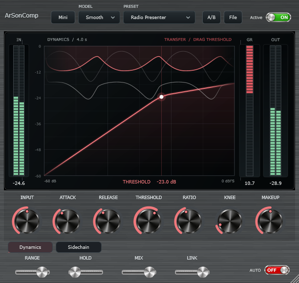
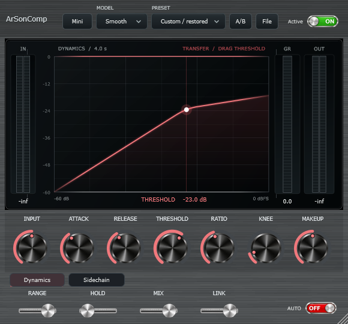
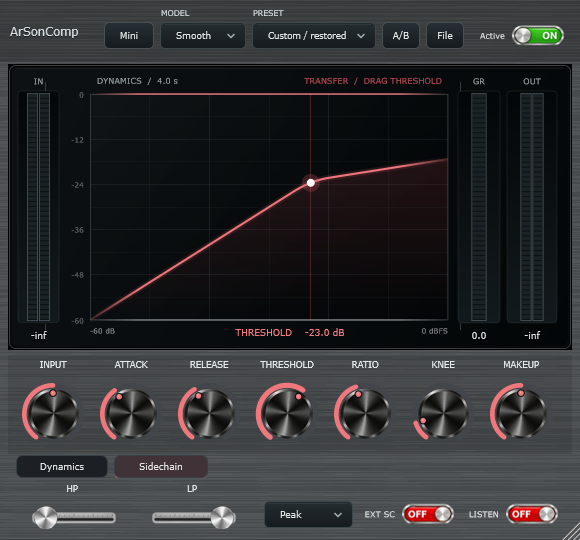
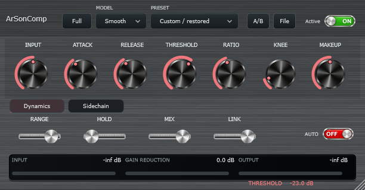
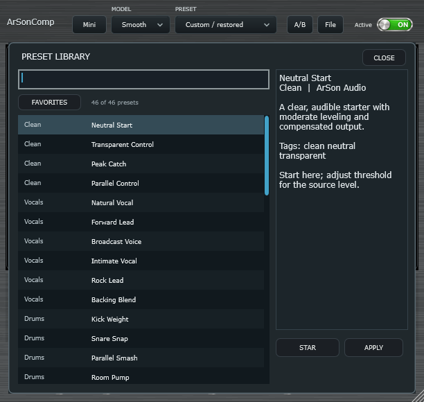

# ArSonComp

**[Official download website](https://masarray.github.io/arson-comp/)** · [Windows / macOS / Linux installers](https://masarray.github.io/arson-comp/#downloads) · [Source and releases](https://github.com/masarray/arson-comp/releases)

**Real-time dynamics for vocals, music, podcasts, streaming, and live mixing.**

[](https://github.com/masarray/arson-comp/actions/workflows/release-installers.yml)
[](https://github.com/masarray/arson-comp/actions/workflows/build.yml)
[](https://github.com/masarray/arson-comp/releases/tag/v0.2.0-rc.1)
[](LICENSE)

ArSonComp is an open-source compressor built with a reusable C++17 DSP engine and JUCE 8 interface. Use it as a **VST3 plug-in** in your DAW/mixer or run it **Standalone**. The default signal path introduces **zero algorithmic samples of latency**; audio-interface, driver, and host-buffer latency still exist.

<p align="center">
  <a href="docs/images/arsoncomp-full.png"></a>
</p>
<p align="center"><sub>Actual Windows JUCE editor screenshot from M7 • Full mode 612 × 580</sub></p>

## Get ArSonComp

**[Download v0.2.0-rc.1 — official GitHub Release](https://github.com/masarray/arson-comp/releases/tag/v0.2.0-rc.1)**

| Operating system | One-click / recommended package | Installer behavior |
| --- | --- | --- |
| **Windows 10/11 x64** | [Inno Setup EXE](https://github.com/masarray/arson-comp/releases/download/v0.2.0-rc.1/ArSonComp-0.2.0-Windows-x64-Setup.exe) | VST3 + Standalone; per-user or all-users; uninstall support |
| **Ubuntu / Debian x86_64** | [DEB package](https://github.com/masarray/arson-comp/releases/download/v0.2.0-rc.1/ArSonComp-0.2.0-Ubuntu-Debian-amd64.deb) | Install through system Software Center |
| **Other desktop Linux x86_64** | [Portable tar.gz](https://github.com/masarray/arson-comp/releases/download/v0.2.0-rc.1/ArSonComp-0.2.0-Linux-x86_64-Portable.tar.gz) | Per-user install/uninstall scripts, no sudo |
| **macOS 11+ · Intel and Apple Silicon** | [Universal PKG](https://github.com/masarray/arson-comp/releases/download/v0.2.0-rc.1/ArSonComp-0.2.0-macOS-Universal-AdHoc.pkg) | VST3 + Standalone; ad-hoc signed, **not notarized** |

[macOS VST3-only ZIP](https://github.com/masarray/arson-comp/releases/download/v0.2.0-rc.1/ArSonComp-0.2.0-macOS-VST3-Universal.zip) · [SHA-256 checksums](https://github.com/masarray/arson-comp/releases/download/v0.2.0-rc.1/SHA256SUMS.txt) · [Installation guide](docs/INSTALL-PUBLIC.md)

After installing, restart/rescan your VST3 host and look for **ArSonComp**. The Mac installer may show Gatekeeper warnings because it is not Apple notarized. Do not disable Gatekeeper globally.

## Why ArSonComp

- **Three original causal compressor models:** Clean, Feedback and Smooth.
- **Useful dynamics:** Threshold, Ratio, Knee, Attack, Hold, Release, Range, Input, Makeup, stereo Link and parallel Mix.
- **Flexible detector:** Peak/RMS, mono/stereo external sidechain, HP/LP detector filtering, and Listen SC.
- **See what's happening:** live compression transfer/history LCD with independent input, gain reduction and output meters.
- **Fast preset workflow:** 46 original factory presets, categorized search, favorites, A/B, user Save/Open, host automation and state recall.
- **Live-friendly UI:** Full/MINI modes and separate Dynamics/Sidechain pages; matte graphite brushed-metal body, silver control artwork.
- **Real-time DSP:** framework-independent core, bounded telemetry queue, no GUI work or filesystem operations in the audio callback.

## Screenshots — real software, not concept art

| Dynamics at minimum size | Sidechain controls |
| :---: | :---: |
| [](docs/images/arsoncomp-minimum.png) | [](docs/images/arsoncomp-sidechain.png) |

| MINI workflow | Factory preset browser |
| :---: | :---: |
| [](docs/images/arsoncomp-mini.png) | [](docs/images/arsoncomp-presets.png) |

[Open the full GUI gallery and screenshot provenance](docs/PRODUCT-SHOWCASE.md).

## First sound

1. Insert the VST3 on a vocal/music channel, or open Standalone and configure the real input/output device.
2. Choose **Clean**, start around **2:1**, and lower Threshold until the GR meter shows roughly **3–6 dB**.
3. Adjust Makeup for safe output headroom. Compare Active and Bypass at similar perceived loudness.
4. Enable Sidechain only when detector filtering or an external signal is needed.

Start physical audio testing at **48 kHz / 128 samples** and move to 64/32 only when stable. See the [hardware test guide](docs/WINDOWS-QUICKSTART.md).

## Release quality and transparency

**v0.2.0-rc.1 is a public Release Candidate — not a certified production-stable audio release.** The [cross-platform CI run](https://github.com/masarray/arson-comp/actions/runs/41273600039) passed Windows, Linux and macOS builds/tests/packaging. CI does not prove glitch-free audio on physical interfaces or all DAWs, independent pluginval certification, commercially matched sound quality, or notarized macOS installation.

[Current release status](docs/RELEASE-STATUS.md) · [Validation record](docs/VALIDATION.md) · [Architecture](docs/ARD.md) · [Report a problem](https://github.com/masarray/arson-comp/issues/new/choose) · [Contributing](CONTRIBUTING.md)

## Build and licensing

Requires CMake 3.22+, C++17 and JUCE 8.0.12 pinned to a verified commit. Visual Studio 2022 (Windows), Xcode (macOS), or [JUCE Linux dependencies](https://github.com/juce-framework/JUCE/blob/master/docs/Linux%20Dependencies.md).

```sh
cmake -S . -B build -DCMAKE_BUILD_TYPE=Release
cmake --build build --parallel 2
ctest --test-dir build --output-on-failure
```

For Visual Studio use `cmake -S . -B build -A x64` and build/test with `--config Release`.

License: [AGPL-3.0](LICENSE). Respect JUCE and Steinberg ASIO licensing/redistribution requirements. ArSonComp's source, DSP and GUI are original; references to other commercial compressors indicate design goals, **not** sonic equivalence or affiliation.

Built by [ArSon Audio](https://github.com/masarray).